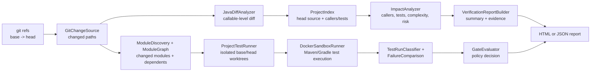

# Architecture

CodeCritic is one Java CLI. It answers three questions about a change between
two Git refs:

1. Which callables changed?
2. Which callers, tests, and modules are likely affected?
3. Do the affected tests prove a behavioral difference?

The CLI can stop after impact analysis or run the project's test suites in
isolated Docker sandboxes and apply a gate policy.

## Verification flow



## Change detection

`GitChangeSource` resolves both refs with `git rev-parse`, reads changed paths
with `git diff --name-status -M -z`, and loads the head source tree once through
`git ls-tree` plus a batched blob reader.

`JavaDiffAnalyzer` parses both revisions with JavaParser. Each callable gets a
stable identity:

```text
<fully-qualified-class>#<method-name>(<parameter-types>)
```

Constructors use `<init>`. Bodies, signatures, and cyclomatic complexity are
compared, so a line move alone is not reported as a behavioral change.

## Impact analysis

`ProjectIndex` indexes production callers by method name and test files by path,
selector, and class-name matches. `ImpactAnalyzer` combines caller counts,
affected tests, complexity, and method-change kind into a risk score.

This is a prioritization heuristic, not a reachability proof. It does not
resolve overloads, inheritance, interfaces, reflection, or generated call sites.

## Module selection

`ModuleDiscovery` reads Maven `<module>` entries and Gradle `include(...)`
entries. `ModuleGraph` builds a directed graph and `ModulePlan` expands the
changed modules through reverse dependencies, so a shared module change runs its
dependents.

Selection falls back to the full suite when:

- a build file changed
- a changed path is at the repository root
- the project has only one module
- a changed path maps to no module
- a selected module is missing at either revision
- a root module depends on the selection
- the graph cannot be built confidently

The fallback is deliberate: under-selection is worse than a slow run.

## Differential execution

`ProjectTestRunner` creates temporary Git worktrees for the base and head
revisions. `MavenProjectAdapter` or `GradleProjectAdapter` discovers the test
command and parses Surefire or Gradle XML results.

`DockerSandboxRunner` executes each command inside a bounded container:

- no network by default
- dropped capabilities
- no privilege escalation
- bounded PIDs, memory, and CPU
- read-only root filesystem with writable `/tmp`
- captured stdout/stderr with a byte cap
- a hard process timeout

Docker is a hard boundary. There is no host fallback.

`TestRunClassifier` and `FailureComparison` compare failed-test identities. This
distinguishes a new regression from a suite that was already failing before the
change.

## Gate decisions

`GateEvaluator` applies the requested policy:

| Policy | Fails when |
|---|---|
| `new-failure` | head has a failure that base did not have |
| `any-failure` | head has any test failure |
| `high-risk` | risk band is `HIGH` and the head test result is healthy |
| `never` | never |

The report is written before the exit code is applied. A gate failure returns
`1`; a passing or disabled gate returns `0`; argument, Git, and report-write
errors return `2`.

## Reports

`VerificationReportBuilder` records changed files, method impacts, risk,
warnings, and an evidence ledger. Every claim carries an evidence id so a
reviewer can trace it to a file, line, or test result.

- JSON is machine-readable.
- HTML is a self-contained reviewer view.

## Repository layout

```text
src/main/java/com/codecritic/
  change/    Git change loading, Java parsing, callable diff, project index
  impact/    callers, affected tests, complexity, risk scoring
  exec/      worktrees, module discovery/graph, Maven/Gradle adapters,
             Docker sandbox, process runner, failure comparison, classifiers
  report/    evidence/report builders, gate policy, HTML/JSON renderers
  cli/       picocli command
  CodeCritic.java
src/test/java/com/codecritic/
  Unit and end-to-end tests, including module graph and fallback behavior
docs/
  cli.md, architecture.md, analysis-algorithms.md,
  known-limitations.md, benchmark.md
scripts/
  e2e-module-gate.sh, benchmark-module-gate.sh
```

## Failure handling

- Git errors, invalid arguments, and report-write failures exit `2`.
- Missing Docker, missing build tooling, compile failures, and test timeouts are
  recorded as test setup or execution failures.
- A broken head test result fails the gate even under `new-failure`, because the
  tool cannot prove the absence of a regression.
- Module selection never silently narrows to an unsafe subset; uncertain input
  falls back to the full suite.
